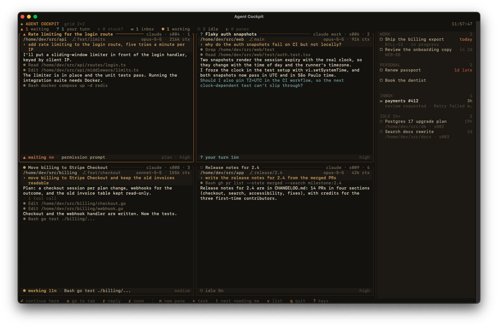

# agent-cockpit

A terminal dashboard for people who run many coding-agent sessions at once.

When a dozen Claude Code, Codex and Antigravity (`agy`) sessions live in a dozen terminal tabs, every
tab looks the same: you can't tell which one is waiting for an answer, which one has been "thinking"
for twenty minutes, or which one finished while you were elsewhere. cockpit finds those sessions on its
own, shows each one as a card with its live conversation, and keeps what needs you in front.



## What it does

- **Finds sessions without setup.** It reads the state files that Claude Code and Codex already write,
  and the process table; nothing has to be started through cockpit.
- **Shows what each session is doing.** Every card is titled with what the session is about and has
  the directory and git branch, the model and how much context it holds, your last prompt, the agent's
  last reply (from its first line, with a closing question kept in view), and a state line with the
  tool call running right now:

  | glyph | state     | meaning |
  |-------|-----------|---------|
  | ▲ | waiting   | the agent is blocked on a question or a permission prompt |
  | ? | your turn | the turn ended with the agent asking you something |
  | ✕ | stuck?    | working, but nothing written for a while (`COCKPIT_STUCK_AFTER`, default 10m) |
  | ✉ | inbox     | an item from an external source (see below) |
  | ● | working   | a turn is in progress |
  | ○ | idle      | the turn ended; your move |

- **Keeps the grid for what is happening.** Sessions idle for over an hour, inbox items and panes whose
  program exited move to a rail on the right, two rows each, so the cards go to the sessions that are
  working or waiting for you. The grid picks its columns and rows from the window size and pages when
  the cards don't fit. `v` switches to a list with a reading pane for the selected session.
- **Runs agents in panes.** `n` starts Claude Code, Codex, agy or a shell inside a card: a real
  interactive terminal. The panes belong to a small background server (`cockpit serve`), so they keep
  running after you close the dashboard and come back when you reopen it. `⏎` on a pane whose program
  exited reopens it, resuming the same conversation when cockpit knows which one it was.
- **Continues any session here.** `⏎` on a Claude Code or Codex session running in a terminal tab
  offers to continue it in cockpit: once you confirm, the agent in the tab stops and the same
  conversation resumes in a pane, in the same directory and with the same Claude profile, so memory,
  skills, hooks and MCP servers are the ones the session already had. You are typing into it right away.
  A session that is mid-turn or waiting for an answer is not cut off: it moves when its turn ends, and the
  card says so until then (`⏎` on it again cancels).
- **Talks back without moving anything.** `o` jumps to a session's Terminal.app or iTerm2 tab; `r` sends a
  message to a Claude Code session without leaving the dashboard.
- **Keeps your to-do list next to the sessions.** The top of the rail is a to-do list: `+` adds a task
  in one line (`call the venue @tomorrow #personal`), space completes it, `⏎` edits it. Tasks from other
  tools (an issue tracker, a team board) can join it through an external source, each in its own
  section.
- **Labels your tabs.** Each terminal tab's title shows its session's state and name (`t` toggles it).
- **A Mac app (optional).** Agent Cockpit.app runs the dashboard in a window of its own, with its own
  Dock icon, and stays in the menu bar when the window is closed: `◆ ▲1 ●3`, a list of sessions, and a
  macOS notification when a session starts waiting, looks stuck, or finishes a turn that took more
  than a minute; clicking it shows that session in the dashboard. `⌥Space` brings the dashboard up
  from any app and puts it away again. Opening the app from Spotlight or the Dock opens the dashboard.

## Requirements

- macOS 13 or later, or Linux
- Go 1.26.11 or later to build; on macOS, the Xcode command line tools (Swift 6.1 or later) for the
  app, whose terminal view is [SwiftTerm](https://github.com/migueldeicaza/SwiftTerm)
- Any of: [Claude Code](https://docs.claude.com/en/docs/claude-code), Codex CLI, Antigravity CLI

On Linux everything runs in any terminal except what needs macOS: going to a session's terminal tab
(`o`), tab titles, and the app. Those use AppleScript and AppKit.

## Install

**Download:** no release is published yet; build from source below. Each
[release](https://github.com/pedro-rodiguero/agent-cockpit/releases) will have
`Agent-Cockpit-<version>-macos.zip` (the app, with `cockpit` inside, for Apple silicon and Intel) and
`cockpit-<version>-<os>-<arch>.tar.gz` (`cockpit` and `cockpit-todo-server`) for macOS and Linux. The app is not notarized yet: the first time, open it with right click ›
Open. For `cockpit` in the terminal, link the one inside the app:
`ln -s "/Applications/Agent Cockpit.app/Contents/MacOS/cockpit" /usr/local/bin/cockpit`.

**From source:**

```sh
git clone https://github.com/pedro-rodiguero/agent-cockpit
cd agent-cockpit
./scripts/install.sh                # cockpit → ~/.local/bin, Agent Cockpit.app → ~/Applications
NO_MENUBAR=1 ./scripts/install.sh   # only the cockpit binary
```

`PREFIX` and `APP_DIR` change the install locations. The script also registers the app to open at login
(a LaunchAgent, `~/Library/LaunchAgents/io.github.pedro-rodiguero.agent-cockpit.plist`) and, when
reinstalling, quits the running app first; your panes keep running. `./scripts/uninstall.sh` removes
what it installed. The first time cockpit focuses a tab, macOS asks whether your terminal may control
Terminal.app or iTerm2.

## Use

```sh
cockpit             # the dashboard
cockpit panes       # panes held by the server (-screen prints their screens)
cockpit json        # one snapshot as JSON
cockpit open <id>   # focus a session's tab, or open an inbox item's link
cockpit config      # the settings in effect and what was detected
cockpit select <id> # select a session in the open dashboards
cockpit todo        # the to-do list; `add call the venue @tomorrow`, `done 2`, `reopen`
```

| key | action |
|-----|--------|
| `←↑↓→` `hjkl` | move; right from the last column enters the rail · `tab` next · `1`–`9` card on this page · `[` `]` page · `g` `G` first and last |
| `⏎` `i` | type into a pane · continue a tab's session here (asks first) · reopen an ended pane · open an inbox item |
| `o` | go to the session's terminal tab · `p` moves a Claude Code or Codex session from its tab into a pane (asks first) |
| `ctrl-q` | leave a pane (every other key goes to the agent) · `ctrl-z` zooms in or out of it |
| `n` | new pane: `←→` picks the agent (one entry per Claude profile); the folder starts at `~/Desktop/` and completes as you type, like a shell: matching folders are listed, `tab` fills in what they share and then cycles through them (`shift-tab` back, `esc` returns to what you typed) |
| `r` | send a message to a Claude Code session |
| `z` | zoom the selected card · typing goes to a zoomed pane · `z` or `esc` back to all panes |
| `x` | close a pane (stops its agent) · questions take `y`/`⏎` or `n`/`esc` |
| drag | select text inside one pane, copied when you let go · click selects a card |
| wheel | scroll a pane back through its history (5000 lines); scrolling to the bottom or typing returns to the live screen. A full-screen program such as Claude Code scrolls itself: it gets the wheel when it asks for the mouse, arrow keys otherwise |
| `!` | next card that needs you · `a` show only those |
| `v` | grid or list · `t` tab titles on/off · `q` quit (panes keep running) |
| `+` | new task: `#group` and `@date` (`today`, `tomorrow`, `25/12`, `2027-01-31`) are optional |
| `space` | complete the selected task · `u` reopens it · `⏎` or `e` edits it · `x` deletes it |
| `?` | every key; the footer always shows the ones for the selected card |

## Configuration

Settings live in `config.json` next to the to-do list (`~/Library/Application Support/agent-cockpit/`
on macOS, `~/.config/agent-cockpit/` on Linux). The app edits it in **Settings** (`⌘,`); by hand, every
field is optional. `cockpit config` prints the settings in effect and what cockpit found.

```json
{
  "theme": "system",
  "quietAfter": "2h",
  "accounts": { "claude": ["~/.claude", "~/.claude-work"] },
  "sources": { "off": ["agy"] },
  "todo": { "defaultGroup": "Personal", "fold": { "Side project": "Personal" } },
  "app": { "opacity": 0.85, "blur": true, "fontSize": 14 }
}
```

[docs/configuration.md](docs/configuration.md) describes every field. Theme, opacity and the to-do
settings apply within seconds; accounts and sources when the dashboard starts (the app restarts it).
These variables win over the file:

| variable | default | |
|----------|---------|---|
| `COCKPIT_STUCK_AFTER` | `10m` | how long a working session may stay silent before it counts as stuck |
| `COCKPIT_CLAUDE_DIRS` | `~/.claude` and every `~/.claude-*` | Claude Code config dirs, colon-separated, default profile first |
| `COCKPIT_SOURCES` | all but those turned off | comma-separated sources to enable (`claude,codex,agy,tasks,<external>`) |
| `COCKPIT_COLOR` | detected | `truecolor` or `256`; cockpit uses 24-bit color only where the terminal announces it (Terminal.app before macOS 26 does not) |

The to-do list itself is `todo.json` in the same folder. `cockpit todo` reads and changes it from the
command line (`-json` for scripts), which is how a chat bot or a phone shortcut can add to it. Completed
tasks move to `todo-done.jsonl` after a week.

### The to-do list on your phone

`cockpit-todo-server` keeps a copy of the list on a server of your own and serves a web app to add to the
iPhone's home screen: the list by group, quick add, complete, edit, delete, offline. The computers sync
with it every 30 seconds: paste a device token made in the app into the Mac app's Settings › To Do, or
run `cockpit todo connect https://todo.example.com`. When a sync fails the dashboard's header says so, and
`cockpit todo status` says why. Sign-in follows OWASP ASVS level 2, with optional 2FA. See
[docs/todo-server.md](docs/todo-server.md) for running it and [docs/security.md](docs/security.md) for
the security routine.

Claude Code itself has one config dir, `~/.claude`, or the one `CLAUDE_CONFIG_DIR` names. Using several
accounts side by side, each with its own dir, is a cockpit convention: any `~/.claude-<name>` dir with a
`sessions/` folder is read as profile `<name>` (or list the dirs in `COCKPIT_CLAUDE_DIRS`), and panes for
it start with `CLAUDE_CONFIG_DIR` set to that dir. A profile other than the default one can keep a long-lived OAuth token (from
`claude setup-token`) in `<profile dir>/token`; panes started for that profile use it.

## Sources

| source | where the state comes from | precision |
|--------|----------------------------|-----------|
| claude | `<config>/sessions/<pid>.json`, kept current by Claude Code, plus the transcript | exact |
| codex  | the rollout `.jsonl` the `codex` process writes; the last turn event | exact for turns |
| agy    | the conversation database the `agy` process holds open; written in the last 20s means working | estimated, never "waiting" |
| tasks  | cockpit's to-do list | exact |

Anything else (a review queue, an issue tracker, a team inbox) can show up as cards through an
**external source**: an executable named `cockpit-source-<name>` on your `PATH` that prints a JSON array
of sessions. See [docs/sources.md](docs/sources.md).

## How it works

[docs/architecture.md](docs/architecture.md) explains the parts and how they fit;
[docs/protocol.md](docs/protocol.md) describes the pane server's wire format.

Some of what cockpit reads (Claude Code's session files and messaging socket, Codex rollouts) is
internal to those tools rather than a documented interface. [docs/compatibility.md](docs/compatibility.md)
lists what cockpit depends on and the versions it was checked against.

## Contributing

See [CONTRIBUTING.md](CONTRIBUTING.md).

## License

[MIT](LICENSE)
